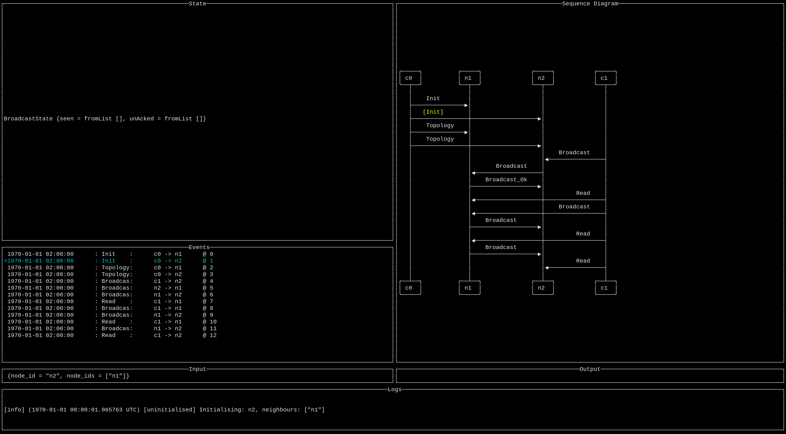

# Domain-specific debugger

*Work in progress, please don't share, but do feel free to get involved!*

## Motivation

Most people associate the word debugger with some stepping through a program
and being able to inspect how the memory (variables) change over time.

In our case we got a DSL for writing nodes in a distributed system. Our DSL is
deterministic and each node processes a single incoming event at the time,
which makes it easy to write a custom (or domain-specic) debugger.

## Big picture

In addition to memory (the state of each node) we can also visualise how
messages flow between the nodes:

## Possibilities to explore

When the state grows big (many fields), it's helpful to show a diff of the
fields that changed rather than just the new state.

This debugger can be used to debug failing tests, but one can also imagine
keeping a ring buffer of events (say the last 100 events) and dump those on
errors. That way one can debug how errors occurred after the fact. One would
need to take snapshots of the state every 100 events for that to work,
otherwise we wouldn't be able to replay what happened.
